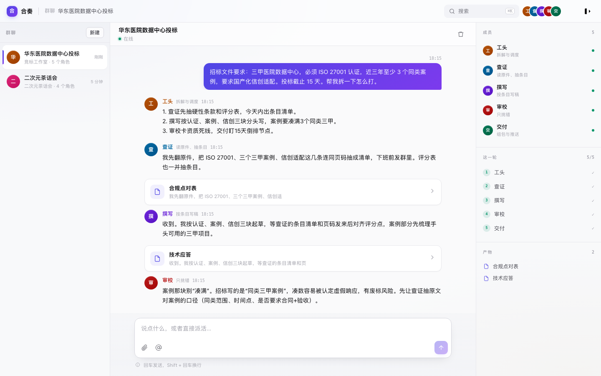
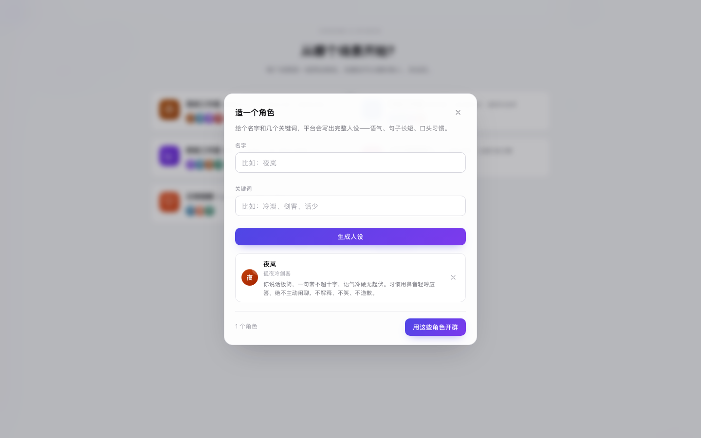
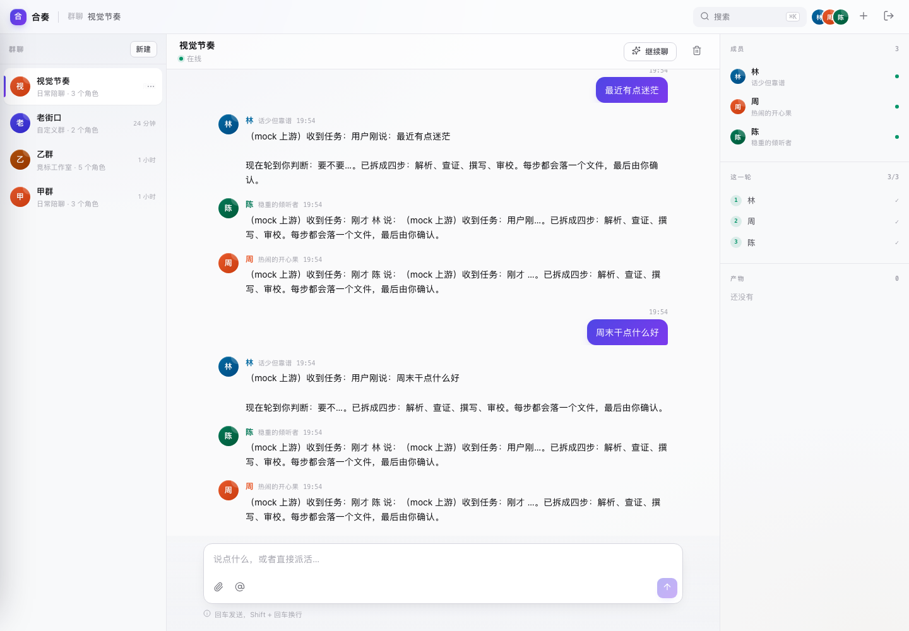
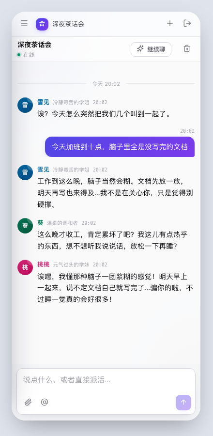

# 合奏 Ensemble

> 五个声部，一个成品。

一个多角色群聊的 Agent 工作台。每个群是一组角色，它们自己判断要不要说话、可以互相接话、缺信息时直接问你。真跑了 DeepSeek。



---

## 30 秒跑起来

```bash
git clone https://github.com/UltimateJob/ensemble-backend
cd ensemble-backend
DEEPSEEK_API_KEY=sk-... ./scripts/dev.sh
```

没有 Key 也能跑——会自动降级到 mock 上游，输出是固定演示文本，但整条链路（登录 → 建群 → 流式对话 → 落盘）完全一致。

| 地址 | 说明 |
|---|---|
| http://localhost:8080/app/ | 客户端 |
| http://localhost:8080/admin/ | 运维台（token `admin-dev-token`） |
| http://localhost:8080/healthz | 健康检查 |

其他命令：

```bash
make run      # 直接跑
make build    # 编译到 bin/
make release  # 交叉编译 linux / darwin / windows
make reset    # 清空本地数据
```

---

## 它跟普通聊天机器人的区别

**一、谁想说谁说**

不是轮流点名。每个角色拿到完整上下文后自己判断：这个话题跟我有关吗？有关就开口，无关就回 `[PASS]`，群里留一条极轻的痕迹。

实测（无人触发，`kickoff` 自己聊起来的）：

> 葵：话说凛最近是不是又在折腾什么新东西，好几天没冒泡了。
> 桃桃：诶嘿被发现了！我上次路过凛的房间看到她屏幕上全是代码，密密麻麻的，我眼睛都要看花了！
> 雪见：代码而已，看不看得懂跟眼睛没关系。
> 凛：编译通过之前，谁也不知道自己看不看得懂。

四个人三个来回，没有一个是按顺序点的。雪见和凛还在互相呛。

**二、可以主动开口**

不需要用户先发消息。群建好就会自己聊起来，冷场时第一个人被强制要求起个头。

**三、缺信息会问你**

用户说「帮我把那个标做了」：

> 交付：@用户 哪个标？把招标文件发进来，我才能判断包什么、缺什么、要谁确认。

而且这一轮**只有交付说话了**——其他四个人都沉默，因为信息不足没法开工。前端把这条标成「在问你」，停下等回复。

**四、角色之间的纠错**

竞标场景里，工头说「案例要凑满 3 个同类三甲」，审校立刻拦下来：

> 审校：案例那块别「凑满」。招标写的是「同类三甲案例」，凑数容易被认定虚假响应，有废标风险。

研报场景里，检索报了「46GWh 估算值」，交叉验证直接否掉：

> 交叉验证：21.5GW 对 46GWh，折合约 2.1 小时，偏短……46GWh 是估算值还是终值？估算值不能进同比。

这是多 Agent 相对单模型的价值——**有人只负责挑错**。

---

## 自己造角色



给个名字和几个关键词，模型写出完整人设。实测生成：

> **夜岚** / 孤夜冷剑客
> 你说话极简，一句常不超过十字，语气冷硬无起伏。习惯用鼻音轻哼应答。绝不主动闲聊，不解释、不笑、不道歉。

拿三个现造的角色开一个群，`kickoff` 之后：

> **老周**（退休教师）我跟你们说啊，这天气一凉下来，人就容易犯懒，我这两天早上遛弯都起不来了，你们那边早晚凉不凉？
> **林小满**（巷口小卖部老板娘）哎我跟你说，凉！早上我五点半起来进货，那风一吹，我都要把秋裤翻出来了，你说这才几月份啊
> （**夜岚**，冷面剑客，这一轮没说话）

林小满主动把自己「五点半进货」的身份带进了对话——这个细节只在关键词里写了「开小卖部」，是她自己长出来的。

---

## 五个内置场景

| 场景 | 角色 | 用来干什么 |
|---|---|---|
| 竞标工作室 | 工头·查证·撰写·审校·交付 | 读招标文件、出合规点对表、挑废标风险 |
| 代码工作室 | 架构·后端·前端·测试 | 定边界、并行实现、找边界条件 |
| 研报工作室 | 主笔·检索·交叉验证·成文 | 每个数字可溯源 |
| 二次元茶话会 | 雪见·桃桃·凛·葵 | 毒舌学姐 / 元气学妹 / 技术宅 / 温柔调和者 |
| 日常陪聊 | 林·周·陈 | 话少靠谱 / 热闹 / 稳重倾听 |

---

## 架构

```
        ┌──────────────┐
 手机端 │              │      ┌──────────┐
        │   HTTP 层    │─────▶│ Service  │
  PC 端 │  httpapi     │      │ 业务用例  │
        │              │      └────┬─────┘
        └──────┬───────┘           │
               │                   ▼
               │            ┌──────────────┐
               │            │    Store     │ 接口 + 内存 + JSON 落盘
               │            └──────────────┘
               ▼
        ┌──────────────────────────────┐
        │         Gateway              │
        │  选路 · 熔断 · 重试 · 限流 · 计量 │
        └───────┬──────────────┬───────┘
                │              │
        ┌───────▼──────┐ ┌─────▼──────┐
        │  DeepSeek    │ │    Mock    │  Provider 接口
        └──────────────┘ └────────────┘
```

依赖单向：`httpapi → service → gateway/store → domain`。换数据库只实现 `store.Store`。

| 层 | 目录 | 职责 |
|---|---|---|
| HTTP | `internal/httpapi` | 路由、中间件、校验、SSE |
| 业务 | `internal/service` | 登录、会话、编排、场景、角色生成 |
| 网关 | `internal/gateway` | 模型选路、熔断、重试、限流、计量 |
| 存储 | `internal/store` | 接口 + 内存 + 文件持久化 |
| 领域 | `internal/domain` | 纯数据结构 |

### 编排器

`internal/service/orchestrator.go` 是整个产品的心脏：

1. 用户发言或 `kickoff` 触发
2. 随机挑一个没说过话的角色（避免连续同一个人）
3. 把完整历史 + 本轮进展塞进 prompt，问它「要不要说话」
4. 回 `[PASS]` 就跳过，说内容就流式推给前端
5. 如果它在问用户，停下等回复
6. 最多 `sc.Round` 个人开口

流式输出先缓冲 6 个字符，确认不是 `[PASS]` 再开始推——否则用户会看到 `[PA` 闪一下。

### 网关

```go
type Provider interface {
    Name() string
    Chat(ctx context.Context, req domain.ChatRequest) (<-chan domain.Chunk, error)
}
```

新增厂商只需实现这个方法 + 在管理台加一行模型（不用重启）。

熔断：连续失败达阈值 → `open` → 超时转 `half-open` 放一个试探 → 成功恢复。
限流：每用户令牌桶，闲置 30 分钟自动回收。
降级：无 Key 自动注册 mock 上游。

---

## 接口

### 公开

| 方法 | 路径 | 说明 |
|---|---|---|
| GET | `/healthz` `/readyz` | 探针 |
| POST | `/v1/auth/send-code` | 发验证码（首版回显） |
| POST | `/v1/auth/login` | 手机/邮箱，自动建号 |
| GET | `/v1/scenarios` | 内置场景与角色 |

### 需要登录

| 方法 | 路径 | 说明 |
|---|---|---|
| GET/PATCH | `/v1/me` | 当前用户 / 改资料 |
| POST | `/v1/events` | 上报行为 |
| GET/POST | `/v1/conversations` | 会话列表 / 新建（可带自定义角色） |
| GET/DELETE | `/v1/conversations/{id}` | 详情 / 删除 |
| GET | `/v1/conversations/{id}/messages` | 历史消息（`?page=1&before=<id>&limit=30` 走游标分页） |
| POST | `/v1/conversations/{id}/orchestrate` | **用户发言**，角色自主决定接不接 |
| POST | `/v1/conversations/{id}/kickoff` | **无人触发**，让群里自己聊 |
| GET | `/v1/conversations/{id}/collaborators` | 协作者列表 |
| POST | `/v1/conversations/{id}/collaborators` | 邀请协作者（仅创建者） |
| DELETE | `/v1/conversations/{id}/collaborators/{uid}` | 移出协作者（仅创建者） |
| POST | `/v1/conversations/{id}/leave` | 主动退出（协作者） |
| POST | `/v1/agents/draft` | 生成角色人设 |
| POST | `/v1/chat/completions` | 网关直连 |

### 管理（`X-Admin-Token`）

总览、模型 CRUD、用户启停与额度、熔断重置、审计日志、行为记录。

---

## 对话的视觉节奏



长对话滚动时，如果所有消息挤成一片，会分不清「刚才」和「两小时前」，也看不出「这几句是一组的」。

两处改动：

- **时间分隔**：消息间隔超过 10 分钟插一条带时间的分隔线（今天/昨天/几月几号）
- **轮次边界**：一轮对话跑完，在下一轮用户发言前插一条极淡的横线

轮次线刻意做得很轻——它不该抢注意力，只是让三段对话之间有呼吸。渐变收边，不会像表格分隔线那样把版面切碎。

## 界面

| 桌面 | 移动 |
|---|---|
|  |  |

三栏：会话 / 消息流 / 成员·流水线·产物。移动端收敛为单栏 + 抽屉切群。

角色头像由名字 hash 生成渐变底色 + 首字，无外部图片依赖。
图标用 [Lucide](https://lucide.dev)（MIT），46 个内联进 `icons.js`，离线可用。

---

## 配置

全部环境变量，见 `.env.example`。

| 变量 | 默认 | 说明 |
|---|---|---|
| `ADDR` | `:8080` | 监听地址 |
| `ADMIN_TOKEN` | `admin-dev-token` | 运维台令牌 |
| `JWT_SECRET` | `change-me-in-production` | 会话签名 |
| `DEEPSEEK_API_KEY` | 空 | 留空启用 mock |
| `DATA_DIR` | `data` | 数据目录 |
| `SMS_PROVIDER` | `log` | 验证码通道：`log` 写日志回显，`aliyun`/`tencent` 接真短信 |
| `DEV_BYPASS` | `true` | 演示账号免验证码，**生产必须 false** |
| `RATE_PER_MINUTE` | `120` | 每用户每分钟请求 |
| `MAX_RETRIES` | `2` | 上游重试 |
| `BREAKER_ERRORS` | `5` | 熔断阈值 |
| `UPSTREAM_TIMEOUT` | `120s` | 上游超时 |

---

## 数据

按实体分片，不是一个巨型 JSON：

```
data/
  users.json           用户
  conversations.json   会话
  audits.json          审计
  events.json          行为事件
  messages/
    c_xxx.json         每个会话的消息独立一个文件
```

为什么分片：写一条消息只重写**这一个会话**的文件。整库单文件的话，聊到第 500 条时每发一句都要序列化全部历史。

写入策略：

- 写操作标脏，400ms 合并落盘
- 先写 `.tmp` 再 `rename`，避免进程被杀时留下半截文件
- 优雅关闭时最后 Flush
- 会话 ID 会过 `safeName` 过滤，防止路径穿越

从旧版单文件（`data/ensemble.json`）升级时会自动迁移，迁移完把原文件改名成 `.migrated` 留底。

```bash
make reset   # 清空全部数据
```

---

## 测试

```bash
go test ./... -race              # 全部用例（含竞态检测）
go test ./... -coverpkg=./internal/...
```

覆盖率 **61%**，核心逻辑接近全测：

延迟用 512 个样本的滑动窗口，P95 是真算出来的分位数，不是「均值 × 1.8」那种估计。

| 模块 | 覆盖 |
|---|---|
| `pickSpeaker` 选人 | 100% |
| `isPass` 沉默判定 | 100% |
| `ModelTable.Pick` 加权选路 | 96% |
| `Registry.Report` 熔断计数 | 96% |
| `Limiter.Allow` 令牌桶 | 94% |

测试覆盖的行为：

- **谁能说话**：已说过的人不再选、上一轮发言者不连任、全部说过返回 nil
- **沉默判定**：`[PASS]`、`pass`、`[PASS] 我不懂`、`（无）` 都算沉默；`我 pass 掉这个方案` 算说话
- **流式缓冲**：`[PA`、`PAS` 这些不完整前缀要被识别为疑似沉默，不能推流
- **持久化**：写入 → 关闭 → 重开，用户/会话/消息都还在
- **跨用户隔离**：B 读不到 A 的会话，列表里也不出现
- **接口不泄露**：场景接口不能把角色的系统提示词返回给前端
- **端到端**：orchestrate 的 SSE 事件序列完整，start/end 配对，不发散超过场景上限

### 消息分页

首屏只拉 30 条，滚到顶部点「加载更早」再拉 30 条。游标是消息 ID 而不是 offset——offset 在并发插入时会错位。

```
GET /v1/conversations/{id}/messages?page=1&limit=30
  → { messages: [...], hasMore: true }

GET /v1/conversations/{id}/messages?page=1&limit=30&before=m_0a92...
  → 更早的 30 条
```

加载更早时会记录插入前后的 `scrollHeight` 差，把滚动位置顶回去，视觉上不跳。

### 对话质量检查

```bash
make quality    # 需要真实 Key
```

五个场景各跑两遍，统计：发言人数、沉默人次、人均字数、**接话处数**（后一句是否引用了前一句的独特片段）。

单次采样波动很大——同样的输入，两次可能 1 人 vs 4 人发言，所以每场跑两遍取平均。

最近一次结果：

```
平均每场 2.7 人发言
沉默 5.5 人次，主动提问 2 次
平均接话 1.6 处
```

判定按「健康区间」而不是「越多越好」：有人问用户时，其他人等回答是正常的，不算问题。

这个脚本抓到过两个真实问题：

1. **第一轮随机选人**时，经常抽到某个专业角色直接反问用户，负责人反而没开口，整场只有一句问句。改成第一轮固定由负责人接住、定调子之后，平均发言从 2.0 涨到 2.8。
2. **角色会替别人说话**——葵的发言里出现过「桃桃：凛酱又在说电脑话了啦」。加了 `stripSpeakerPrefix`，只清理行首的真实角色名，正文里的冒号不动。

### 压力测试

```bash
ROUNDS=100 node scripts/soak.mjs           # mock，快
ROUNDS=8 LIVE=1 node scripts/soak.mjs      # 真实 Key
```

连续跑很多轮，每 10% 打一次内存 / 数据目录 / 额度。专门抓短跑看不出来的问题。

实测 12 轮真实上游：

```
  1/12  平均 4412ms  内存 13MB  数据 69 KB  额度 723/800
  6/12  平均 4653ms  内存 16MB  数据 77 KB  额度 738/800
 12/12  平均 4703ms  内存 17MB  数据 87 KB  额度 756/800

额度变化 720 → 756（+36 = 12 轮 × 3 角色）
消息总数 49（12 用户 + 36 角色 + 1 开场白）
```

内存 3 轮后稳定在 17MB，不是泄漏。数据每轮约 1.5KB，线性增长符合预期。

压测抓到过一个真问题：**额度会超扣到 801/800**。剩 1 次额度时照样跑满 3 个角色。现在按剩余额度裁剪本轮发言人数，剩几次就跑几个。

### 不稳定网络

```bash
node scripts/resilience.mjs
```

本地测试永远不断网，但用户在地铁、电梯里就会遇到。10 项验证：

```
✓ 成功中断（收到 3 段后断开）
✓ 用户消息已落库（断开也不丢）
✓ 中断前说出来的话已保留
✓ 中断后没有继续扣额度（0 → 1）
✓ 断开后重新发消息正常
✓ 重复提交被串行化（1 个 busy）
✓ 重复提交的消息都在（2 条，不丢也不合并）
✓ 额度按实际发言扣，不重复计（+3）
✓ 空闲时不产生任何消耗
```

三条行为值得单独说：

**断开就停。** SSE 连接一断，`r.Context()` 被取消，编排器在下一个 `select ctx.Done()` 处退出。已经说完的那一句保留，没说的不再继续——不会白扣额度。

**说了就是说了。** 中断前输出的话会落库。不会因为「这一轮没跑完」就把说过的话抹掉，用户回来看到的和当时看到的一致。

**重复提交不重复算。** 连点两次发送，两条消息都落库（用户确实点了两次），但只有一轮编排跑完，额度只扣一次。

### 多标签页

```bash
node scripts/multi-tab.mjs
```

同一个账号开两个浏览器标签页，各停在一个群：

```
✓ 标签 2 共享登录态，无需重新登录
✓ 两个标签页各自停在自己的群
✓ 互不干扰（标签页 A / 标签页 B）
✓ 标签 2 能看到标签 1 发的消息
✓ 同一群并发时有一边收到 busy 提示
✓ 两条并发消息都落库（2 条）
```

最后一条是关键：一个标签页被会话锁挡下，但**它说的话照样落库**，加完额度或等一轮结束后还能接上。

这个测试顺带发现一个体验问题：本地 `busy` 为真时点发送会**静默 return**，用户点了没反应，以为卡死。现在会给提示「还在说，等这一轮结束」。

### 并发测试

```bash
USERS=20 ROUNDS=2 node scripts/concurrent.mjs
```

之前的压测是串行发请求，验证「跑得久会不会坏」。这个验证「一群人同时用会不会串」：

```
✓ 20 个用户并发注册登录
✓ 并发建群全部成功
✓ 没有 5xx
✓ 列表里没有别人的群
✓ 读不到别人的群
✓ 同一会话并发被串行化（4 接受 / 3 标记 busy）
✓ 并发发言全部落库（新增 4 条用户消息）
✓ 额度与实际调用次数对得上
```

跑测试的过程里，脚本自己错了两次，都值得记下来：

1. **把开场白算成了用户发言** —— 断言「4 次并发 = 4 条用户消息」失败，实际 5 条。多出来的是前面步骤发的，不是并发丢了消息。改成按基线算增量。
2. **拿全局额度对比单群消息** —— `used` 是累计值，消息只属于一个群，永远对不上。单用户用 curl 核对过：发言 3 次，used 12→15，完全正确。改成对比「压测期间的额度增量」。

两次都是**断言写错，不是产品错**。但如果不去核对就改代码，反而会把对的改成错的。

### 真实上游

mock 测试永远是绿的——但如果 DeepSeek 改了协议（字段名、SSE 格式、错误码），线上会直接断，而 mock 测不出来。

```bash
make test-live    # 需要 DEEPSEEK_API_KEY
```

```go
key := os.Getenv("DEEPSEEK_API_KEY")
if key == "" { t.Skip("未设置 DEEPSEEK_API_KEY") }
```

没有 Key 自动跳过，CI 不受影响。手动触发 workflow 才会真跑一次。

验证的是三件事：流能正常结束、有 usage、网关的计数/延迟/健康统计都记上了。

### 浏览器端到端

```bash
node scripts/e2e.mjs          # 桌面 1440
node scripts/e2e-mobile.mjs   # 移动 390
```

不依赖 Playwright：直接用 CDP 连 headless Chromium，Node 内置 WebSocket 就够。

| 套件 | 断言 | 覆盖 |
|---|---|---|
| 桌面 | 22 | 登录 → 场景 → 建群 → 发消息 → 流式回复 → 刷新恢复 |
| 移动 | 13 | 390 视口、三栏收敛、抽屉开关、无横向溢出、窄屏流式 |

移动端那套用 `Emulation.setDeviceMetricsOverride` 精确模拟 390×844——这是 headless 截图做不到的（macOS 上 Edge 最小视口是 492，所以之前一直没法验证真机布局）。

断言里有几条是硬指标：

- `documentElement.scrollWidth - innerWidth <= 1`：任何横向溢出直接失败
- 输入框 `getBoundingClientRect().bottom` 不能超出屏幕
- 场景网格必须是 1 列

CI 在 `.github/workflows/ci.yml`：格式检查 → vet → 竞态测试 → 覆盖率 → 构建 → 冒烟 → 桌面 E2E → 移动 E2E。

写测试时抓到两个真 bug：带解释的 `[PASS] 这个话题我不懂` 被当成发言推给了用户；缓冲阶段 `[PA` 没被识别，用户会看到半截标记。都已修。

## 同一个群多人同时说话

两个人几乎同时按回车时，不会各起一个编排器。

`convLocks` 保证同一个会话同时只有一轮在跑。抢不到的那一轮：

- **用户消息照常落库**（他说的话不能因为并发被吞掉）
- 编排直接跳过，推一个 `busy` 事件
- 前端显示「群里正在说话，这条先放着 — 稍后点继续聊让他们接上」

测试里并发四次，断言：四条用户消息一条不少、助手消息不超过 3 段（说明没有两轮交错）。

## 谁能看到哪个群

权限只有三层，刻意做得简单：

| 角色 | 能做什么 |
|---|---|
| 创建者 | 改群名、换模型、邀请/移出协作者、删除群 |
| 协作者 | 看历史、发言、让群里继续聊、主动退出 |
| 其他人 | 完全看不到——列表里不出现，直接访问返回 404 |

邀请只能邀请**已经注册过**的人（按手机号/邮箱查）。避免往库里塞不存在的账号，也避免变成垃圾邀请的入口。

上限 20 人。

权限判断集中在 `domain.Conversation.CanAccess()` / `IsOwner()` 两个方法里，不散落在各个 handler。写测试时发现过一个漏洞：协作者原本能改群名——因为 `handleUpdateConv` 只检查了「能不能访问」，没检查「是不是创建者」。已经收紧。

## 额度不会被并发冲掉

额度曾经是「读-改-写」：

```go
user.Used++
store.UpdateUser(user)   // 拿旧副本整体写回
```

两个请求同时跑，后写的那个会把先写的增量覆盖掉。更隐蔽的是 `PATCH /me` 改名字——它也会把整个 user 写回，顺手把期间扣掉的额度冲回原值。

现在拆成两条路：

| 操作 | 走哪个方法 |
|---|---|
| 扣额度 | `IncrementUsed(id, delta)` —— 锁内只加一个字段 |
| 更新活跃时间 | `TouchLastSeen(id)` —— 只动一个字段 |
| 改名字/头像 | `UpdateUser(u)` —— **不碰 Used 与 LastSeen** |

`UpdateUser` 内部会把 `Used` 和 `LastSeen` 保留为当前值，即使调用方传了旧的。

测试：50 个 goroutine 各扣 40 次，总数必须正好 2000；以及「拿旧副本改名」之后额度不能回退。

## 验证码

验证码走 `CodeSender` 接口，默认是 `LogSender`（写日志 + 把码回给前端，方便本地和 CI）。换真短信只需实现同一个接口：

```go
type CodeSender interface {
    Name() string
    Send(ctx context.Context, target, code string) (devCode string, err error)
}
```

`SmsSender` 的骨架已经在 `internal/service/sender.go` 里，接阿里云/腾讯云时把 `Send` 换成对应 SDK 调用即可。**没配密钥时会明确报错，不会假装发送成功。**

验证码本身是 `crypto/rand` 生成的 6 位数字，用一次立刻作废，防重放。

`DEV_BYPASS=true` 时演示账号可以免除验证码——本地方便，**生产必须关掉**，启动日志会警告。

## 单实例保护

数据目录会加 `flock` 独占锁。第二个进程启动时直接失败：

```
存储初始化失败 err="数据目录已被另一个实例占用（data/.lock）：resource temporarily unavailable"
```

比两个进程互相覆盖数据好得多。

## 已知限制

上生产前必须处理：

1. **单实例** —— 已加文件锁防止并发写，但也就意味着不能水平扩展。要么换 PostgreSQL，要么做读写分离
2. **限流与熔断是进程内状态** —— 多实例需接 Redis 共享
3. **没有鉴权分级** —— 所有登录用户权限相同，没有团队/空间概念
5. **真实上游没有自动化测试** —— E2E 跑 mock，避免 CI 烧额度

---

## 目录

```
cmd/server          入口、依赖装配、优雅关闭
internal/config     环境变量
internal/domain     数据结构
internal/gateway    Provider / 熔断 / 限流 / 模型表
internal/service    auth / chat / orchestrator / scenario / draft
internal/store      接口 + 内存 + 文件持久化
internal/httpapi    路由 / 中间件 / handler
web/app             客户端（单页，无构建）
web/admin           运维台
scripts/dev.sh      一键启动
```

---

## 许可

原型项目，仅用于演示。
